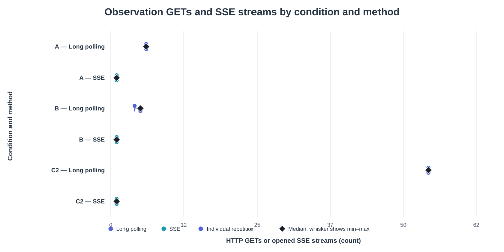
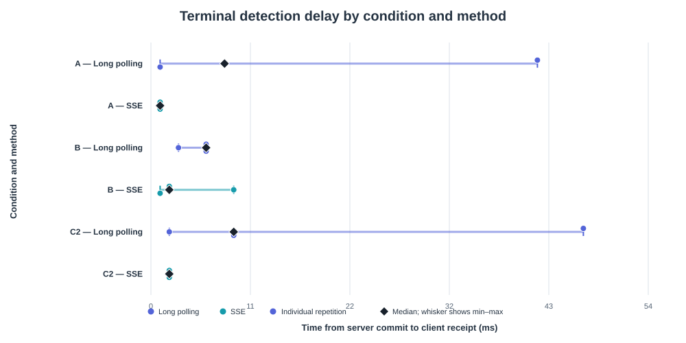

# ImageLab Assessment 3 — Server-Sent Events implementation and comparison

Teryn Guzman & Kelvin Gordon · CMPS 4191

## 1. Predictions and method

**Predictions.** Predictions for all three conditions were written in `experiments/v3/predictions.md` and committed in `e852c00` on 9 Nov 2026 at 18:30:35 −0600, about 1 hour 48 minutes before the first measured run (the first server log record is at 20:19:09 −0600). For each condition and method we predicted requests or streams, job events, database reads, version gaps, heartbeats and detection delay. From Assessment 2 we expected long polling to need 6, 5 and 54 requests in conditions A, B and C, with about twice as many reads (11–12, 9–10, 108). We expected SSE to use one stream and one read per wake-up (6, 6 and 55 reads, including the extra statement for a completed job's variants), two heartbeats in A only, no version gaps, and a 2–15 ms detection delay for both methods because they share the same in-process notifier.

**Implementation.** `GET /v1/jobs/{id}/events` returns 404 for an unknown or malformed job before any stream begins. Otherwise it sets `Content-Type: text/event-stream; charset=utf-8` and `Cache-Control: no-cache`, then immediately sends the current complete snapshot as a named `job-update` event. Every frame ends with a blank line and is flushed; flushing makes the frame available to the browser without ending the response. The handler subscribes to the job's notifier before its first read, then waits. A notification is only a wake-up: the handler re-reads PostgreSQL and sends a snapshot only if its version is newer than the last one sent, so several commits can coalesce. The stream ends after the terminal snapshot, sends a `: heartbeat` comment every 15 s when idle, and sends no `id:` field, so there is no `Last-Event-ID` replay. A disconnect or server shutdown ends only the handler, never the worker. In the browser one `EventSource` feeds the same renderer as the polling modes and closes on a terminal snapshot. On an error it keeps the same object so the browser can reconnect, and if the browser gives up it shows "Unable to check status" with **Try again**. It never marks the job failed. In manual checks with a 10 s worker delay, Stop observing mid-job left the job to complete (a plain GET ten seconds later showed it completed at version 5), and Resume opened one new stream that returned the completed snapshot with no second upload. With the stream's request blocked in DevTools, the page showed "Unable to check status" without marking the job failed, and after unblocking, Try again opened one new stream that returned the completed snapshot.

**Setup.** One computer running Windows 10.0.26300.9711, Go 1.26.6, PostgreSQL 18.6 and Chrome 155.0.8059.86 (64-bit), with Python 3.12.0 for analysis. The Go API, PostgreSQL and browser were all local, with one observer, the tab in the foreground, and DevTools open with no throttling (latency `none`). Every run used `picture1.jpg` and started with an empty worker queue. Server flags were: A `-quiet-delay=30s`; B none; C a 10 s simulated phase at 200 ms intervals (`-simulation-duration=10s -simulation-interval=200ms`). The brief calls this third condition C, and the interface and logs label it C2. Simulated progress is stored separately in `simulation_step` and never counts as a stored variant.

**Procedure.** 3 conditions × 2 methods × 3 repetitions gave 18 measured runs, ordered long polling then SSE (repetition 1), SSE then long polling (repetition 2), and long polling then SSE (repetition 3). A run is observed from the first GET or stream open to the terminal snapshot, so the upload is outside the window. Short polling was not re-measured, because the brief makes SSE versus long polling the required comparison.

**Measures.** Detection delay is the browser's `Date.now()` on receiving the terminal snapshot minus the server's `post_commit_at` log time for the same job and version, on one computer. Processing duration is `started_at` to `completed_at`. Database reads count the SQL statements the observation handler attempted (two for a completed job, which also loads its variants). Heartbeats are counted separately from job events, and we count requests and streams, not TCP connections. The raw logs are in `experiments/v3/raw/`, and `experiments/v3/analyze.py` generated the run table, summary and graphs in `experiments/v3/results/`. It found exactly 18 runs and no notes needing review.

## 2. Results

Medians of three runs per cell, with the minimum–maximum in brackets for detection delay. Percentages compare SSE with long polling; negative means SSE used less. All 18 runs are in `results/summary.csv` and `results/summary.md`, and the appendix lists them run by run.

| Condition | Requests / streams: long vs SSE | Change | DB reads: long vs SSE | Change | Detection delay (ms): long vs SSE |
|---|---:|---:|---:|---:|---:|
| A — quiet job (30 s) | 6 vs 1 | −83% | 12 vs 6 | −50% | 8 (1–42) vs 1 (1–1) |
| B — real progress | 5 vs 1 | −80% | 9 vs 6 | −33% | 6 (3–6) vs 2 (1–9) |
| C — fast updates (C2) | 54 vs 1 | −98% | 108 vs 55 | −49% | 9 (2–47) vs 2 (2–2) |

| Condition | Method | Job events received | Heartbeats | Version gaps | Processing (ms) | Stream duration (s) |
|---|---|---:|---:|---:|---:|---:|
| A | Long polling | — | — | 0 (0–0) | 30320 (30298–30334) | — |
| A | SSE | 5 (5–5) | 2 (2–2) | 0 (0–0) | 30350 (30316–30356) | 30.417 (30.374–30.504) |
| B | Long polling | — | — | 0 (0–1) | 224 (222–250) | — |
| B | SSE | 5 (5–5) | 0 (0–0) | 0 (0–0) | 208 (204–215) | 0.381 (0.272–0.438) |
| C2 | Long polling | — | — | 0 (0–0) | 10255 (10222–10272) | — |
| C2 | SSE | 54 (54–54) | 0 (0–0) | 0 (0–0) | 10227 (10210–10232) | 10.305 (10.276–10.32) |

**Graph 1 (observation GETs and SSE streams).** SSE sits at 1 in every condition, while long polling sends one request per observed version (6, 5 and 54). In A, one of the six requests in each run was a 204 returned at the 20 s holding deadline while the job was quiet.

**Graph 2 (detection delay).** Every run detected completion within 47 ms of the server commit. SSE medians are 1–2 ms and long-polling medians are 6–9 ms. The slow long-polling runs (42 ms in A, 47 ms in C) were the first run after a server restart, when the handler's final database read took about 41–46 ms against about 7–8 ms later. The likely cause is database connection warm-up, which we did not test.

**Database reads.** Long polling reads about twice per request, once before waiting and again after being woken. SSE reads once per wake-up, so totals were roughly halved.

**Version gaps.** There was one gap in 18 runs. In B long polling repetition 1 (job `24ec2a13…`) the browser received versions 1, 3, 4 and 5 and skipped 2. Versions 2 and 3 were committed about 22 ms apart and the handler's read after waking took about 35 ms, so it already saw version 3. Nothing was lost, because the API sends the latest snapshot rather than an event history.

**Predictions against results.** By the median of three repetitions, 29 of 30 predicted values were met; the only miss was SSE detection in A (1 ms against 2–15 ms). Judged strictly (all three repetitions inside the range), 22 of 30 were met. The misses were small: the slow long-polling detection runs, the B long-polling run above (4 requests, 8 reads, 1 gap), one C long-polling run with 107 reads instead of 108, and a few SSE detections of 1 ms. All SSE counts, reads and heartbeats matched exactly.

## 3. Interpretation and recommendation

**Where SSE helped.** SSE replaced 6, 5 and 54 requests with one stream and cut database reads by about a third to a half. In C, one stream carried all 54 updates where long polling needed 54 request cycles.

**Processing time.** Processing did not get faster. It was the same for both methods (about 30.3 s, 0.2 s and 10.2 s), and only the moment the browser learned the result changed, by a few milliseconds.

**Detection delay.** SSE was lower and tighter, but every run finished under 50 ms and each cell has three runs, so we do not claim SSE is meaningfully faster on localhost.

**Fewer requests do not prove lower total cost.** An SSE stream keeps a handler, response writer, request context, notifier subscription and heartbeat ticker alive for the whole job (30.4 s in A) and sent two heartbeats per run. Long polling also holds a handler for up to 20 s and re-subscribes with each request. We measured requests, reads, heartbeats and stream duration, but not memory, goroutines or CPU, so we cannot say which costs less overall. Only the lower database reads for SSE are measured.

**Gaps and reconnects.** Both methods send complete snapshots, so a gap is not data loss, and a reconnecting `EventSource` receives the latest snapshot. Keeping every event would need an event log with ids and `Last-Event-ID` replay, which this version does not provide.

**Recommendation.** For today's ordinary jobs (about 0.2 s, as in B) both methods are cheap. We recommend SSE as ImageLab's progress channel, because once jobs are long (A) or updates frequent (C) it removed most requests and about half the reads while detection stayed in milliseconds. We would keep long polling as the fallback, since it needs no long-lived response and is simpler where streaming may be buffered or blocked.

## 4. Limitations and conclusion

The evidence is three runs per cell on one computer with one image and one observer, so it supports a classroom comparison, not general performance or capacity claims. The unusual long-polling results all came from the first run after a restart, and because that run was always long polling (repetition 1), any warm-up cost fell on long polling. The quiet delay and simulated updates are artificial workloads. Detection delay compares two clocks on one machine, database reads count statements rather than server load, and request and stream counts are not TCP connection counts. Real proxies and networks were not tested.

SSE delivered the terminal state within a few milliseconds in every condition and replaced many requests and about half the database reads with one held stream plus heartbeats, without making processing faster.

## Appendix: run-by-run results (in the order the runs were performed)

| Run | Condition | Method | Rep | Job | GETs / streams | Events | Heartbeats | Gaps | DB reads | Detection (ms) | Processing (ms) |
|---:|---|---|---:|---|---:|---:|---:|---:|---:|---:|---:|
| 1 | A | Long polling | 1 | c09525a5… | 6 | 0 | 0 | 0 | 12 | 42 | 30320 |
| 2 | A | SSE | 1 | 9469507d… | 1 | 5 | 2 | 0 | 6 | 1 | 30316 |
| 3 | A | SSE | 2 | 89eed062… | 1 | 5 | 2 | 0 | 6 | 1 | 30356 |
| 4 | A | Long polling | 2 | d49fc0b3… | 6 | 0 | 0 | 0 | 12 | 8 | 30298 |
| 5 | A | Long polling | 3 | 02f360c3… | 6 | 0 | 0 | 0 | 12 | 1 | 30334 |
| 6 | A | SSE | 3 | 9698ee2f… | 1 | 5 | 2 | 0 | 6 | 1 | 30350 |
| 7 | B | Long polling | 1 | 24ec2a13… | 4 | 0 | 0 | 1 | 8 | 6 | 224 |
| 8 | B | SSE | 1 | c32a3470… | 1 | 5 | 0 | 0 | 6 | 2 | 215 |
| 9 | B | SSE | 2 | 6c07b35c… | 1 | 5 | 0 | 0 | 6 | 9 | 204 |
| 10 | B | Long polling | 2 | 56e29dae… | 5 | 0 | 0 | 0 | 10 | 3 | 222 |
| 11 | B | Long polling | 3 | 821d69f4… | 5 | 0 | 0 | 0 | 9 | 6 | 250 |
| 12 | B | SSE | 3 | 5a89003f… | 1 | 5 | 0 | 0 | 6 | 1 | 208 |
| 13 | C2 | Long polling | 1 | d28305d4… | 54 | 0 | 0 | 0 | 107 | 47 | 10222 |
| 14 | C2 | SSE | 1 | 0eed6451… | 1 | 54 | 0 | 0 | 55 | 2 | 10232 |
| 15 | C2 | SSE | 2 | 531c67de… | 1 | 54 | 0 | 0 | 55 | 2 | 10227 |
| 16 | C2 | Long polling | 2 | 49a265c3… | 54 | 0 | 0 | 0 | 108 | 2 | 10272 |
| 17 | C2 | Long polling | 3 | 798411c0… | 54 | 0 | 0 | 0 | 108 | 9 | 10255 |
| 18 | C2 | SSE | 3 | cde31272… | 1 | 54 | 0 | 0 | 55 | 2 | 10210 |